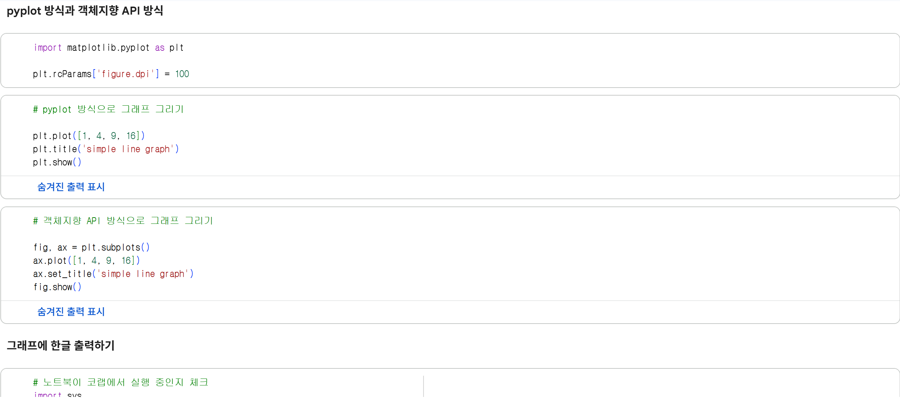
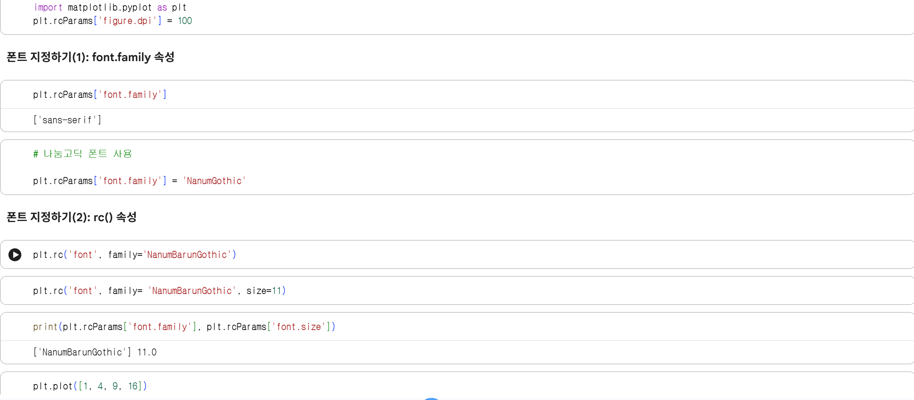
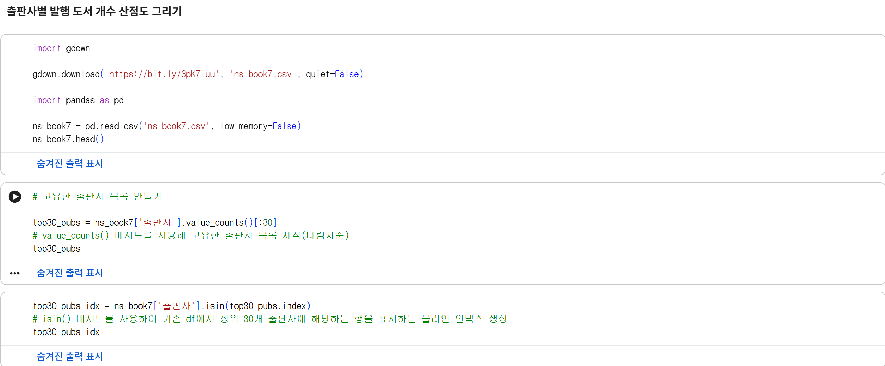
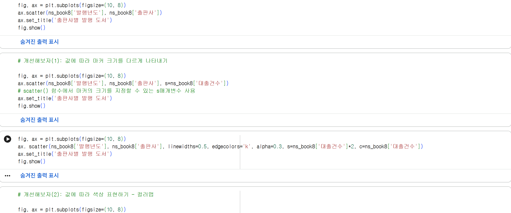
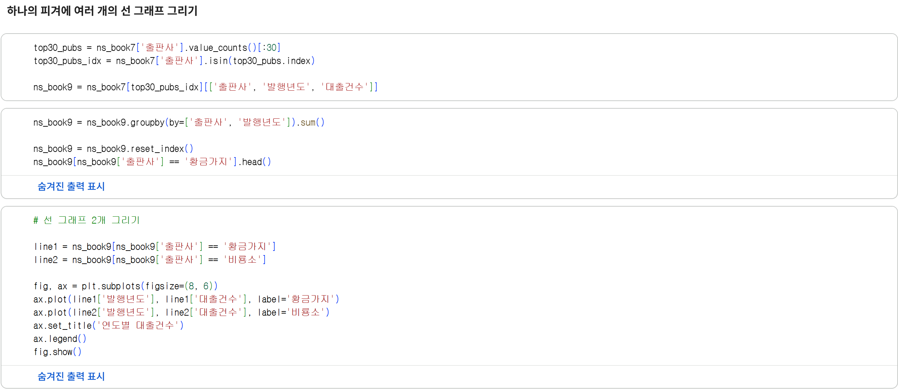
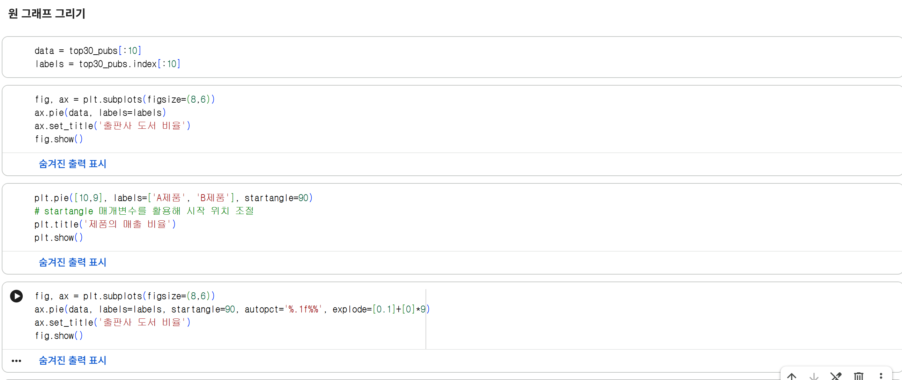

# 데이터분석 6주차 정규과제

📌데이터분석 정규과제는 매주 정해진 분량의 『*혼자 공부하는 데이터 분석 with 파이썬*』 을 읽고 학습하는 것입니다. 이번 주는 아래의 **DataAnalysis_6th_TIL**에 나열된 분량을 읽고 공부하시면 됩니다.

아래의 문제를 풀어보며 학습 내용을 점검하세요. 문제를 해결하는 과정에서 개념을 스스로 정리하고, 필요한 경우 제시된 강의를 참고하여 보완하는 것이 좋습니다.

<!-- 강의 링크는 아래와 같습니다.
https://www.youtube.com/watch?v=XD65UhBMOiI&list=PLVsNizTWUw7FGzSRCkQrPEEe-ljVXgS7k&index=12
https://www.youtube.com/watch?v=NTQ5NXelOfw&list=PLVsNizTWUw7FGzSRCkQrPEEe-ljVXgS7k&index=13
-->


## DataAnalysis_6th_TIL

### 6장 복잡한 데이터 표현하기
#### 01. 객체지향 API로 그래프 꾸미기
#### 02. 맷플롯립의 고급 기능 배우기


## Study Schedule

| 주차  | 공부 범위     | 완료 여부 |
| ----- | ------------- | --------- |
| 1주차 | p.24~81    | ✅         |
| 2주차 | p.84~151   | ✅         |
| 3주차 | p.154~219  | ✅         |
| 4주차 | p.222~279 | ✅         |
| 5주차 | p.282~325 | ✅         |
| 6주차 | p.328~379 | ✅         |
| 7주차 | p.382~430 | 🍽️         |

<br>

<!-- 여기까진 그대로 둬 주세요-->


# 1️⃣ 개념 정리 

## 01. 객체지향 API로 그래프 꾸미기

**그래프를 그리는 두 가지 방식** 
> **pyplot 방식**:    
> matplotlib.pyplot에 있는 함수를 사용     
> 하나의 피겨 객체에 대한 상태를 공유 (동일한 피겨 객체에 적용)
> 
>**객체지향 API**:   
> 명시적으로 피겨 객체와 서브플롯 객체를 만들고 해당 객체의 메서드를 사용     
> 하나의 axes 객체를 가지는 피겨를 생성    
> 복잡한 그래프를 그릴 때 사용 (하나의 피겨에 여러 개의 서브플롯을 추가하거나 피겨 객체의 설정을 바꾸는 등)   

**폰트 지정**
> **font.family 속성**:     
> ex. plt.rcParams['font.family'] = 'NanumGothic'    
> 직접 지정    
>
> **rc() 속성**:     
> ex. plt.rc('font', family= 'NanumBarunGothic', size=11)   
> rc(설정할 그룹, 그룹 하위 속성) / 다양한 설정 가능(폰트 크기 등)

**산점도를 그리고 개선해보자**   
> **마커 조절**   
> - s 매개변수: 마커 크기를 조절    
> - alpha 매개변수: 투명도 조절  
> - edgecolor 매개변수: 마커 테두리 색 바꾸기   
> - linewidths 매개변수: 마커 테두리 선 두께 바꾸기   
> - c 매개변수: 산점도 색 바꾸기    
>
> ex. ax. scatter(ns_book8['발행년도'], ns_book8['출판사'], linewidths=0.5, edgecolors='k', alpha=0.3, s=ns_book8['대출건수']*2, c=ns_book8['대출건수'])

**컬러맵**    
> scatter() 함수가 사용하는 기본값인 viridis 컬러맵 -> jet 컬러맵    
> jet 컬러맵 = 낮은 값일수록 짙은 파란색, 높은 값으로 갈수록 노란색, 붉은색을 띈다.   
> colorbar() 메서드 사용   
>
> ex. fig.colorbar(sc)


## 02. 맷플롯립의 고급 기능 배우기

**하나의 피겨에 여러 개의 선 그래프 그리기**
> 선 그래프를 그리는 plot() 함수를 여러 번 호출하면 됨. 간단   
> 범례 추가: label을 추가, legend() 메서드 호출    
> for문과 슬라이스 연산자를 통해 다수의 선 그래프 생성도 가능(선택 후 그리기)    

**그 중 .. 스택 영역 그래프**
> 하나의 선 그래프 위에 다른 선 그래프를 차례대로 쌓는 것(그래프 면적)    
> stackplot() 메서드를 활용: stack(x축 값, y축 값의 2차원 배열)  ax.stackplot  
> 순서: y축 2차원 배열 생성 -> x축 리스트 생성 -> 그래프 그리기   
> 
> pivot_table(index='', columns=''): 하나의 열을 2차원 배열로 바꾸기   
> get_level_values() 메서드로 열 이름 중 선택한 항목만 가져오기  

**하나의 피겨에 여러 개의 막대 그래프 그리기**    
> 막대 그래프를 그리는 bar() 메서드를 여러 번 호출하면 됨.   
> 막대가 겹쳐지지 않도록 막대의 너비와 위치를 조정 가능   

**그 중 .. 스택 막대 그래프**   
> 겹쳐그려지는 것과 스택 막대 그래프는 다르다는 점   
> 직접 x ->  대신 bar() 메서드의 bottom 매개변수를 사용하여 수동으로 쌓기  
> cumsum() 메서드를 활용하여 값을 누적 후 그리기도 가능 (단, 큰 막대를 가장 먼저 그리기)

**원 그래프 그리기**
> pie() 메서드를 활용: pie(정의된 데이터)   
> 기본적으로 3시 방향부터 배열의 값 크기 순서대로 반시계 방향으로 그려짐 -> startangle 매개변수를 활용해 시작 시점 변경 가능   
> autopct 매개변수: 비율을 표시 가능 (ex. %d로 정수 표기)  
> explode 매개변수: 부채꼴 조각을 원 그래프에서 조금 떨어트리기

**여러 종류의 그래프가 있는 서브플롯 그리기** 
-> axes[n,n] 으로 지정하여 하나의 피겨 위의 여러 종류의 그래프 그리기가 가능


# 2️⃣ 수행 인증








<br>
<br>

# 3️⃣ 확인 문제

## 문제 1.

> **🧚Q. 이번 주차에는 확인문제 대신 그래프 그리기 실습을 진행합니다.
4주차에서 사용했던 캐글 데이터셋을 활용하여, 다양한 요소를 포함한 복잡한 그래프를 직접 작성해주세요.**

```
여기에 코랩 링크를 첨부해주세요!
(제출 전, 코랩의 공유 설정을 ‘링크가 있는 모든 사용자가 보기 가능’으로 변경했는지 반드시 확인해주세요.)

https://colab.research.google.com/drive/1kQ2VCI03g9ANc1NU0g3NESyR2VvPEuW_?usp=sharing
```


### 🎉 수고하셨습니다.
