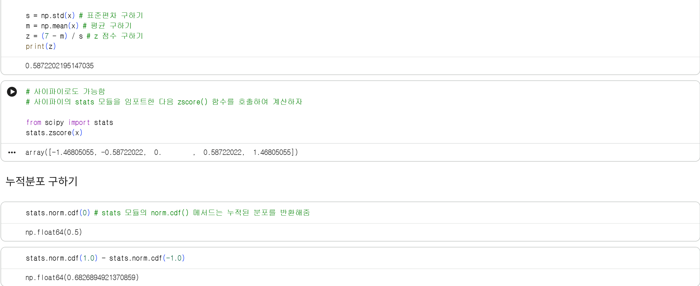
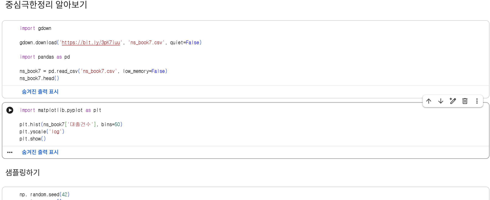
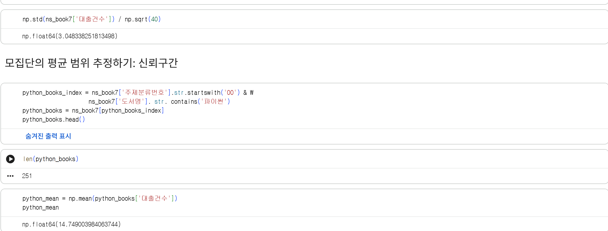
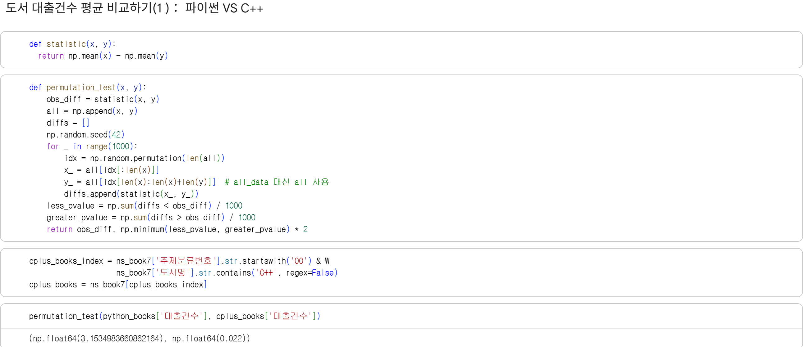
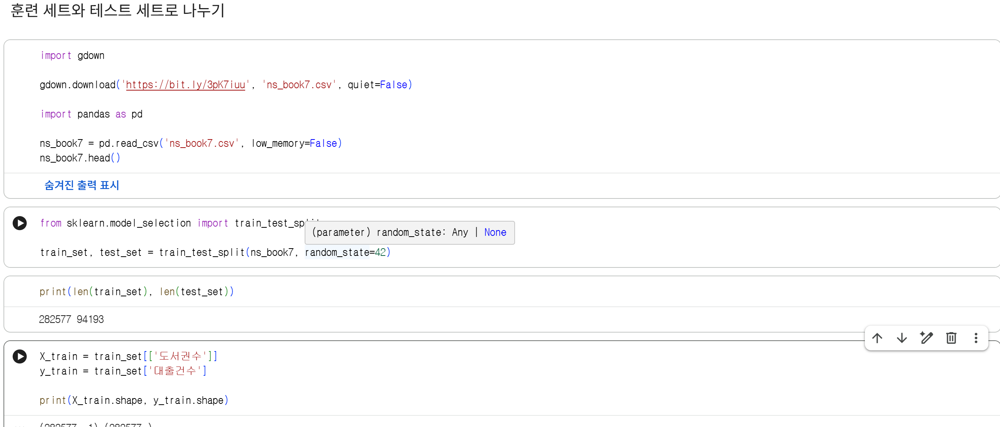
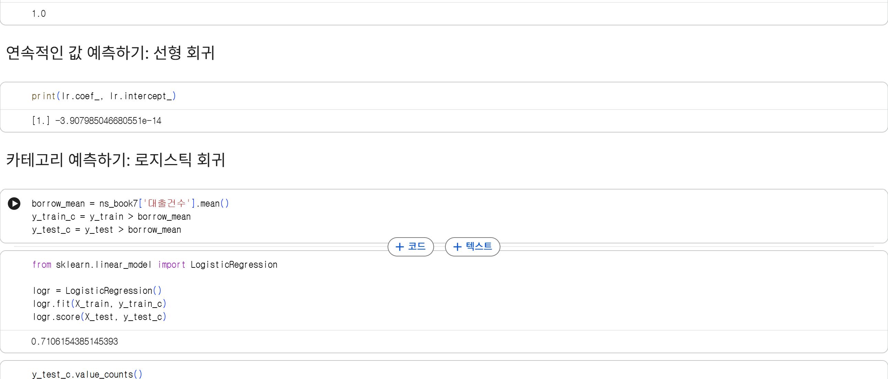

# 데이터분석 7주차 정규과제

📌데이터분석 정규과제는 매주 정해진 분량의 『*혼자 공부하는 데이터 분석 with 파이썬*』 을 읽고 학습하는 것입니다. 이번 주는 아래의 **DataAnalysis_7th_TIL**에 나열된 분량을 읽고 공부하시면 됩니다.

아래의 문제를 풀어보며 학습 내용을 점검하세요. 문제를 해결하는 과정에서 개념을 스스로 정리하고, 필요한 경우 제시된 강의를 참고하여 보완하는 것이 좋습니다.

<!-- 강의 링크는 아래와 같습니다.
https://www.youtube.com/watch?v=R3E4m8fqUSg&list=PLVsNizTWUw7FGzSRCkQrPEEe-ljVXgS7k&index=14
https://www.youtube.com/watch?v=W_cxRstQUk8&list=PLVsNizTWUw7FGzSRCkQrPEEe-ljVXgS7k&index=15
-->


## DataAnalysis_7th_TIL

### 7장 검증하고 예측하기
#### 01. 통계적으로 추론하기
#### 02. 머신러닝으로 예측하기


## Study Schedule

| 주차  | 공부 범위     | 완료 여부 |
| ----- | ------------- | --------- |
| 1주차 | p.24~81    | ✅         |
| 2주차 | p.84~151   | ✅         |
| 3주차 | p.154~219  | ✅         |
| 4주차 | p.222~279 | ✅         |
| 5주차 | p.282~325 | ✅         |
| 6주차 | p.328~379 | ✅         |
| 7주차 | p.382~430 | ✅         |

<br>

<!-- 여기까진 그대로 둬 주세요-->


# 1️⃣ 개념 정리 

## 01. 통계적으로 추론하기

- 가설검정 (영가설, 대립가설, 유의수준)
- 순열검정

---

### 모수검정이란
> - 모수검정 = 모집단(관심 대상이 되는 전체 데이터)에 대한 파라미터(평균, 분산 등)를 추정 by 표본(모집단에서 선택한 일부 샘플)
> - 모집단 데이터에 대해 어떤 가정을 전제로 하고 수행되는 경우가 많음. 예를 들어 정규분포를 따른다거나 ...

### 표준점수 구하기
> - 표준점수(z점수) = 데이터가 정규분포를 따른다고 가정하고, 각 값이 평균에서 얼마나 떨어져 있는지 표준편차를 사용해 편환한 점수
> - 각기 다른 단위를 표준화시켜서 알아보기 좋음 
> - z = (x-모집단의 평균)/모집단의 표준편차

> - 표준정규분포 = 평균이 0이고 표준편차가 1인 정규분포 
> - 누적분포 = z 점수 내에 있는 샘플의 비율 -> **norm.df() 메서드**

### 중심극한정리 알아보기
> - 중심극한정리 = 무작위로 샘플을 뽑아 만든 표본의 평균은 정규분포에 가깝다, 는 이론
> - 표본이 늘어날수록 더욱 정확해진다.
> - 표준오차 = 표본 평균의 표준오차

### 모집단의 평균 범위 추정하기: 신뢰구간
> - 신뢰구간 = 표본의 파라미터(평균)가 속할 것이라 믿는 모집단의 파라미터 범위
> - 위의 z점수 식에서 모집단의 평균을 모른다면 ... 표본의 평균에서 z점수와 표본오차를 곱한 값을 빼면 된다!

---

### 정규분포가 아닐 때 가설 검증하기: 순열검정
> - 순열검정 = 모집단의 분포가 정규분포를 따르지 않거나 모집단의 분포를 알 수 없을 때 사용하는 방법 
> - -> 모집단의 파라미터를 추정하지 않기 때문에 비모수검정 방법 중 하나
> - 두 표본의 평균의 차이를 계산 후 섞고 무작위로 두 그룹으로 나눔(원래 표본의 크기와 동일하도록) -> 다시 평균의 차이를 계산 -> 여러 번 반복해 원래 표본의 평균 차이가 무작위로 나눈 그룹의 평균 차이보다 크거나 작은 경우를 헤아려 p-값을 계산


## 02. 머신러닝으로 예측하기

### 알아 두면 좋은 머신러닝 용어
> - 머신러닝 = 컴퓨터 프로그램을 사용해 데이터에서 패턴을 학습(훈련)하는 방법 
> - 인공지능의 하위 분야 - 머신러닝은 또 지도 학습과 비지도 학습으로 나뉜다. 
> - 우리가 이 책에서 배운 파이썬은 머신러닝에서의 필수 언어&많은 머신러닝 패키지를 사용할 수 있는 툴(대표적으로는 사이킷런)

> - 모델 = 머신러닝으로 학습된 패턴을 저장하는 소프트웨어 객체 
> - -> ex. '이 문제에서는 선형 회귀 모델을 사용하겠습니다.'

> - 머신러닝의 알고리즘은 크게 지도 학습과 비지도 학습으로 나뉜다.
> - 지도 학습 = 데이터에 있는 각 샘플에 대한 정답을 알고 있는 경우 (정답 = 타깃 / 타깃을 맞추기 위한 재료 데이터 = 입력)
> - -> 입력과 타깃이 들어있는 데이터를 사용해 어떤 머신러닝 모델을 훈련한 후, 타깃을 모르는 새로운 입력에 모델을 적용하여 타깃을 예측
> - 비지도 학습 = 입력 데이터는 있지만 타깃이 없는 경우 (정답 데이터를 모으기 위해 매우 어렵거나 비용이 많이 드는 경우)
> - -> ex. 군집(클러스터링) 알고리즘

### 모델 훈련하기
> - 훈련에 대한 검증을 위해 데이터셋을 모두 훈련시키는 게 아니라, 검증을 위해 나누어(남겨)둔다.
> - 입력1, 타겟1을 훈련 세트 > 입력2, 타깃2를 테스트 세트라 부름 ; 테스트 데이터는 전체 데이터의 20~25% 정도 사용
> - 모델을 훈련방법: 알고리즘의 객체를 만들어 fit() 메서드로 호출 후 값 전달
> - 모델을 평가하는 방법: 결정계수를 사용(1에 가까울수록 x, y의 관계가 깊다라고 볼 수 있음)

### 연속적이 값 예측하기: 선형 회귀
> - 선형 회귀 = 선형 함수를 사용해 모델을 만드는 알고리즘 
> - 'y = ax + b' 요 직선의 방정식 활용 
> - -> x는 입력, y는 타깃, 입력에 기울기(가중치) a를 곱하고 y축과 만나는 절편 b를 더하여 예측을 만든 것 ! => 선형 회귀 알고리즘

### 카테고리 예측하기: 로지스틱 회귀
> - 타깃을 연속적인 실수로 생각 -> 회귀 ... 어떤 종류의 카테고리로 생각하기 -> 분류
> - -> ex. 스팸 메일 필터링 => 분류
> - 이진 분류(두 개의 카테고리로 분류) vs. 다중 분류(세 개 이상의 카테고리로 분류)
> - 클래스 = 타깃 카테고리 / 0과 1로 나뉘는데, 0일 때를 음성 클래스, 1인 경우를 양성 클래스 (좋고나쁨의 의미x)
> - 대표적인 분류 알고리즘은 로지스틱 회귀 ! 
> - -> 선형 회귀처럼 선형 함수를 사용하지만, 예측을 만들기 전에 로지스틱 함수를 통해 연속적인 실수 출력값을 1 또는 0으로 변환하는 과정이 존재함.


# 2️⃣ 수행 인증









<br>
<br>

# 3️⃣ 확인 문제

## 문제 1.

> **🧚Q. 어떤 표본의 크기가 충분히 크고(n ≥ 30), 모집단 분산을 알 수 없을 때 모평균에 대한 신뢰구간을 구하려고 한다.
이때 다음 설명 중 가장 적절한 것은 무엇인가?**

```
1️⃣ 표본의 크기가 충분히 크므로 중심극한정리에 의해 표본평균의 분포는 근사적으로 정규분포를 따른다.  
2️⃣ 모집단 분산을 모르므로 신뢰구간을 구할 수 없다.  
3️⃣ 표본이 30개 이상이면 항상 모집단도 정규분포를 따른다.  
4️⃣ 중심극한정리는 모집단이 정규분포일 때만 적용된다.
```

```
여기에 정답을 적어주세요! => 1번
```

## 문제 2.

> **🧚Q. 다음 중 순열검정(permutation test)에 대한 설명으로 가장 옳은 것은 무엇인가?**

```
1️⃣ 모집단이 정규분포를 따른다는 가정을 반드시 해야 한다.  
2️⃣ 표준점수(z-score)를 이용하여 유의확률을 계산하는 방법이다.  
3️⃣ 데이터의 라벨을 무작위로 섞어 귀무가설 하에서의 분포를 직접 구성하는 비모수적 검정 방법이다.  
4️⃣ 표본의 크기가 충분히 클 때만 사용할 수 있다.
```

```
여기에 정답을 적어주세요! => 3번
```


### 🎉 수고하셨습니다.
